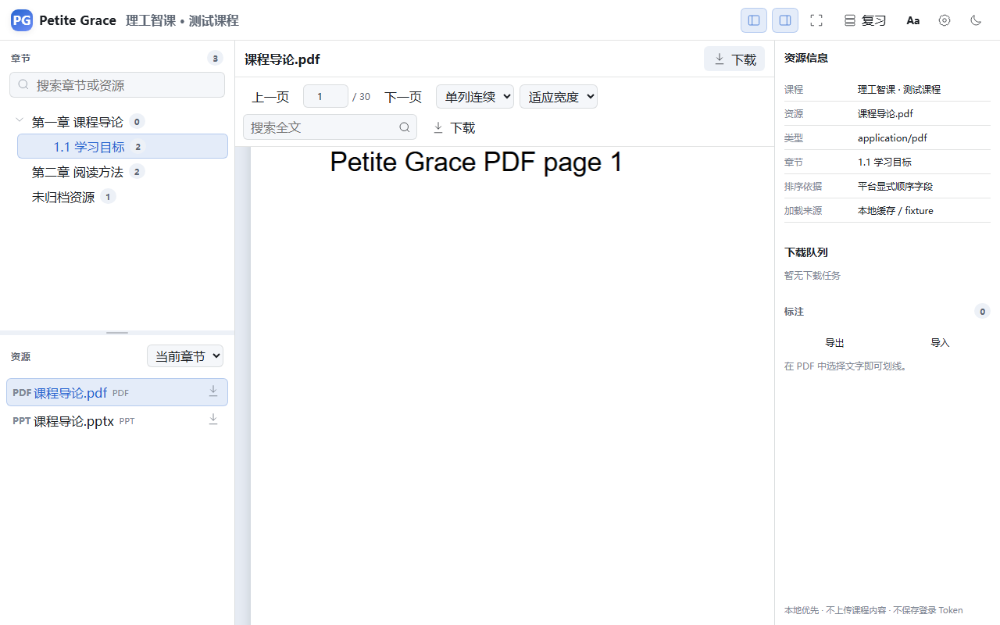
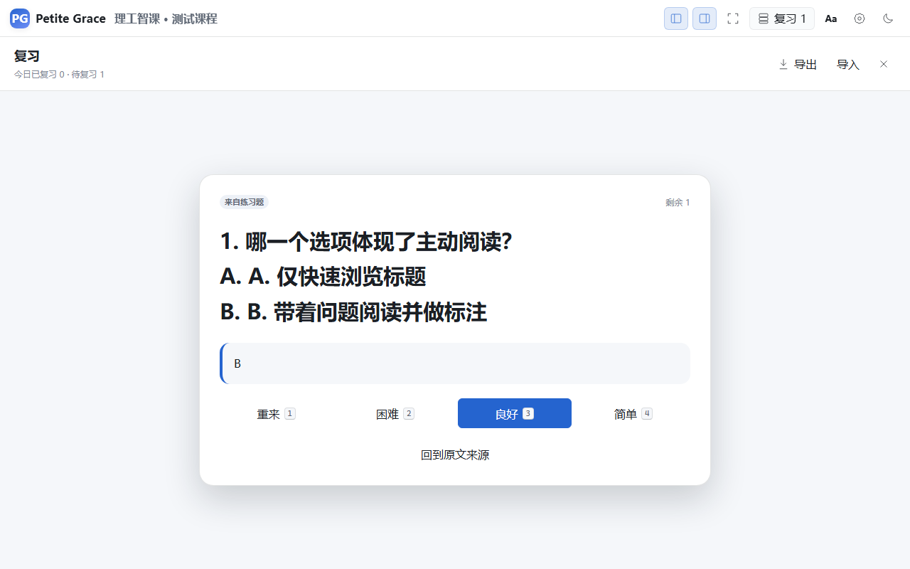
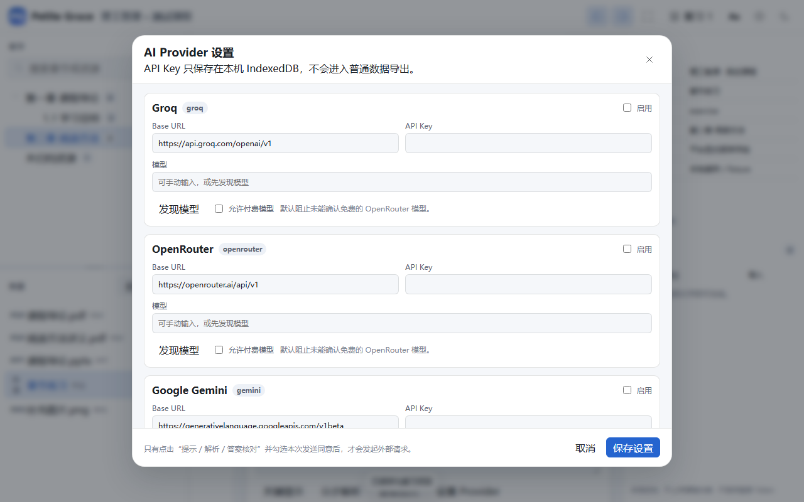

# Petite Grace

> A lightweight course companion for university learners.

Petite Grace brings chapter navigation with natural/local ordering, authorized resource resolution, PDF/PPT reading, MP4/HLS video playback, exercise study aids, bring-your-own-key LLM assistance, highlights, notes, and review into one low-distraction workspace. The first supported platform is Xiaoya (`*.ai-augmented.com`).

## Status

`v0.5.0-rc.2` is a Real-World Compatibility Release Candidate. Automated verification passes, but live Xiaoya acceptance remains `NOT_VERIFIED`, so this repository does not claim a Stable release. Machine-readable evidence is under `docs/acceptance/`.

## Screenshots







## Development

```bash
npm install
npm run dev
npm run test
npm run test:e2e
npm run build
```

The userscript build is written to `dist/petite-grace.user.js`.

## Privacy

Credentials are used only in the active page session and are never persisted. External AI providers are opt-in and receive only the minimum selected context. See [PRIVACY.md](PRIVACY.md) and [SECURITY.md](SECURITY.md).

## License

MIT. See [THIRD_PARTY_NOTICES.md](THIRD_PARTY_NOTICES.md).
