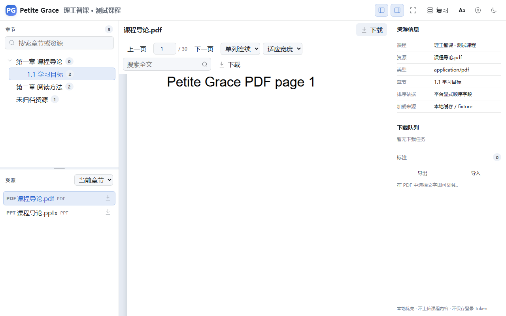
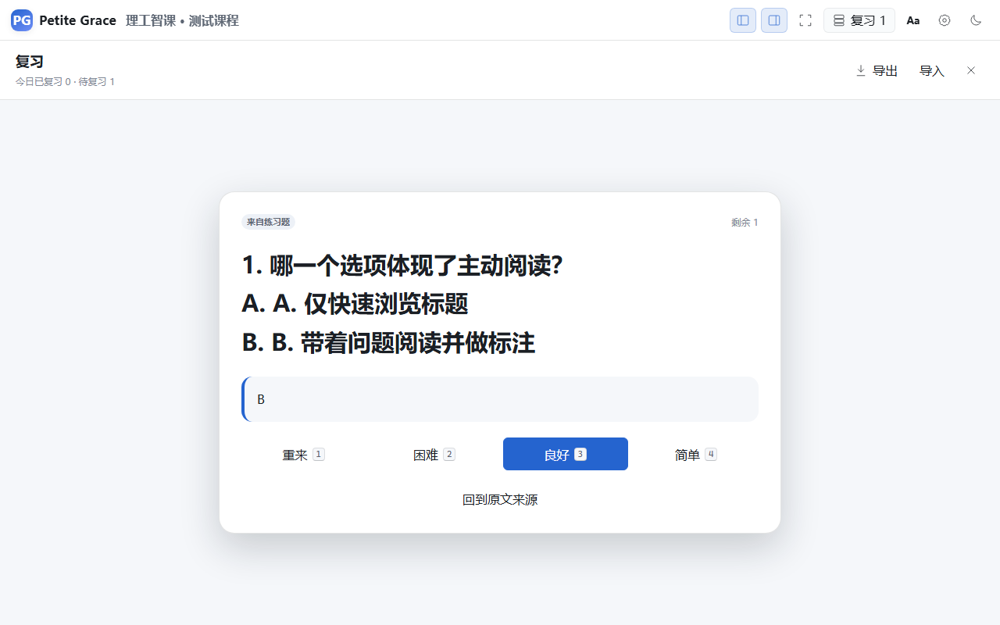
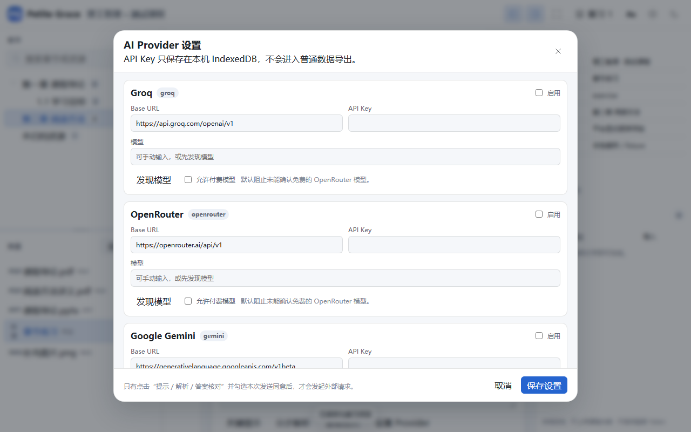

# Petite Grace

> 面向大学生的轻量化课程学习伴侣。

Petite Grace 将课程章节导航、课件下载、PDF/PPT 阅读、作业理解、免费 LLM 学习辅助、划线批注与知识复习整合在一个低干扰的全屏学习工作区中。首个适配平台是小雅教学平台（`*.ai-augmented.com`）。

## 当前状态

`v0.5.0-rc.1` 是 Release Candidate。自动化验证已通过，但真实小雅平台验收仍为 `NOT_VERIFIED`，因此不会伪造 Stable 发布。验收状态以 `docs/acceptance/` 中的机器可读记录为准。

## 界面







## 核心能力

- 章节树与资源树分离的课程导航，保留平台顺序并提供稳定回退
- PDF 单列/双列连续滚动阅读、文本层、搜索、缩放与进度恢复
- PPTX 基础离线预览，明确提示不支持的复杂版式
- 划线、短注释、集中标注侧栏与导入导出
- Groq、OpenRouter、Gemini 和 OpenAI-compatible Provider
- 本地优先的复习卡片与简单 SM-2 风格调度
- Shadow DOM UI 隔离，不覆盖宿主页面全局样式
- 默认不上传课程内容，不保存登录 Cookie，不把 Bearer Token 附加到外域下载地址

## 安装

1. 安装 Tampermonkey、ScriptCat 或兼容的 Chromium 用户脚本管理器。
2. 从 GitHub Releases 安装 `petite-grace.user.js`。
3. 登录小雅平台并打开课程页面。
4. 点击右下角 Petite Grace 入口，进入全屏学习工作区。

## 开发

```bash
npm install
npm run dev
npm run test
npm run test:e2e
npm run build
```

构建产物：`dist/petite-grace.user.js`。

## 隐私与安全

- 登录凭证只在当前页面会话中临时使用，不写入日志、导出文件或 IndexedDB。
- 外部 AI 请求必须由用户显式启用，并且只发送当前题目或明确选择的最小上下文。
- API Key 仅保存在本机 IndexedDB，默认不进入数据导出。
- 第三方课件预览默认关闭。
- 详见 [PRIVACY.md](PRIVACY.md) 与 [SECURITY.md](SECURITY.md)。

## 已知限制

- 小雅 API 可能随平台升级变化；未验证的真实平台路径会明确标记为 `NOT_VERIFIED`。
- PPTX 当前提供基础文本、形状与图片渲染；动画、SmartArt、复杂图表、公式与字体替换不保证还原。
- Chromium 自动化测试已通过；完整兼容矩阵见 [docs/compatibility/browser-matrix.md](docs/compatibility/browser-matrix.md)。

## 许可证

MIT。第三方依赖和参考项目说明见 [THIRD_PARTY_NOTICES.md](THIRD_PARTY_NOTICES.md)。
